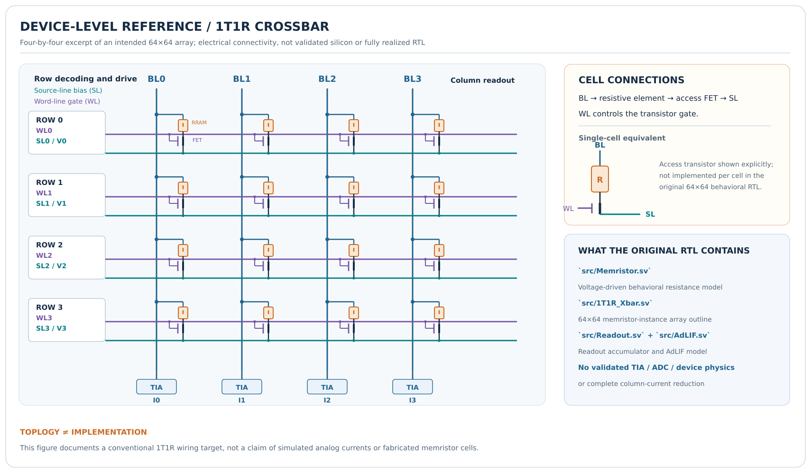
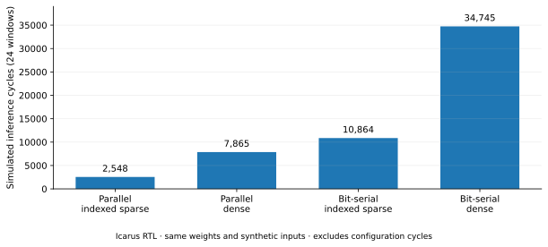

# SV_MemXbar

SystemVerilog models of a memristive crossbar and AdLIF dynamics, accompanied by an independent event-indexed digital inference accelerator. The two implementations investigate different abstraction levels; they do not share a physical compute array.

## Memristor array model



*1T1R reference topology (4×4 detail of a proposed 64×64 organization).* The preserved `src/` modules provide a behavioral resistance model, an array-instance outline, a readout unit and AdLIF dynamics. Access-transistor physics, complete column-current summation, a calibrated JART/TEAM device model, and a fabricated circuit are **not** implemented or demonstrated. See [device-model notes](docs/DEVICE_MODEL_NOTES.md).

The historical design and tests remain in [`src/`](src/) and [`TB/`](TB/). The original image `AI_gen_img.jpg` and prior Git history are retained.

## Digital event-indexed classifier


*Implemented synthesizable RTL.* This independent subsystem accepts 128×128-ROI event coordinates and one temporal-bin bit, coalesces events into 128 indexed features, and performs 128→32→4 quantized inference. The 32-entry associative coalescer supports partial flushes; the first layer uses eight banks with four output lanes per bank. Inferred synchronous memories hold signed INT8 weights, with parallel multiply-accumulate or bit-serial arithmetic. The second layer produces four INT32 class scores.

This is **bank-local digital near-memory computation**, not memristor current summation or a fabricated SRAM-CIM macro. Source, model, testbenches and build commands are under [`cim_vision/`](cim_vision/).

## Verification and performance

| Experiment | Result | Scope |
|---|---:|---|
| Quantized classifier | 1,996 / 2,000 correct (99.8%) | Held-out synthetic motion windows; software oracle |
| Python tests | 11 passed | Numerical reference, coalescing, benchmark parser |
| Icarus HDL suite | Passed | Four MLP modes; coalescer; Boolean CIM; signed extrema; two end-to-end modes |
| Parallel indexed-sparse / dense | 2,548 / 7,865 cycles | 24 frozen windows; weights preprogrammed |
| Bit-serial indexed-sparse / dense | 10,864 / 34,745 cycles | Same 24 windows and weights |
| Legacy `src/` and `TB/` preservation | 6 source/test files unchanged | Historical-source checksum audit |
| Verilator lint and Yosys structural synthesis | Pending current logs | Required before release certification |
| FPGA implementation / physical memory energy | Not measured | No board or silicon validation |



The cycle counts include the testbench's input delivery, stalls and internal sequencing, but exclude weight programming. They are **simulation-cycle measurements**, not FPGA Fmax, wall-clock inference latency or power. The synthetic benchmark is not evidence of recognition accuracy on real event-camera recordings.

Full evidence and commands: [verification record](docs/VERIFICATION.md). Detailed numerical and model results: [`cim_vision/results/software_metrics.json`](cim_vision/results/software_metrics.json).

## Reproduce

The digital accelerator has its own [`Makefile`](cim_vision/Makefile) and [README](cim_vision/README.md). On Ubuntu/WSL with Python, Icarus, Verilator and Yosys installed:

```bash
python3 tools/check_legacy_sources.py
python3 -m pip install -r cim_vision/requirements.txt
make -C cim_vision reference
make -C cim_vision sim-all
make -C cim_vision lint
make -C cim_vision synth
make -C cim_vision bench-rtl
```

Checks stop at the first failure when chained with `&&`; each target is also callable independently. `make synth` is a Yosys structural/memory pass, not technology-mapped FPGA PPA or timing closure. A separate vendor-flow script is provided in `cim_vision/tools/vivado_synth.tcl` but no completed FPGA implementation report is claimed.

## Source organization

- [`src/`](src/), [`TB/`](TB/): preserved behavioral memristor/crossbar/AdLIF work and original testbenches.
- [`cim_vision/rtl/`](cim_vision/rtl/): event coalescing, local weight banks, quantized layers, Boolean-CIM functional experiment.
- [`cim_vision/tests/`](cim_vision/tests/): HDL testbenches and Python reference tests.
- [`cim_vision/models/`](cim_vision/models/): frozen quantized model, weights, inputs, scores.
- [`cim_vision/tools/`](cim_vision/tools/): training, numerical reference, synthesis scripts and benchmark generator.
- [`docs/`](docs/): device and digital architecture diagrams and verification scope.

## References

F. Cüppers et al., “Exploiting the switching dynamics of HfO₂-based ReRAM devices for reliable analog memristive behavior,” *APL Materials*, 7, 091105 (2019). [DOI](https://doi.org/10.1063/1.5108654).

The current device model is not a validated reproduction of that paper's full model.
