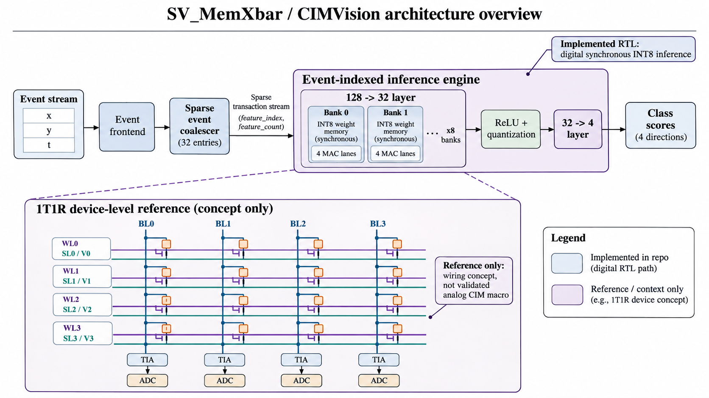

# SV_MemXbar

**SystemVerilog-based neuromorphic hardware: JART-inspired memristive crossbar modeling, adaptive spiking neurons, and event-driven digital inference.**

SV_MemXbar investigates two complementary approaches to neuromorphic computing: behavioral modeling of memristive synaptic arrays and a digital, memory-centric neural-network accelerator for event-based vision.

The repository preserves the original **1T1R memristive crossbar and Adaptive Leaky Integrate-and-Fire (AdLIF) neuron** implementation while extending the project with an independent RTL inference subsystem.

## Architecture Overview



The architecture distinguishes two hardware paths: the original device-inspired memristive crossbar model and the digital event-indexed inference engine. The former provides a behavioral framework for exploring neuromorphic devices and spiking dynamics; the latter performs quantized inference using synchronous local weight memories and digital arithmetic.

## 1. Memristive Crossbar and AdLIF Neurons

The original SystemVerilog implementation explores memristive devices as programmable synaptic elements and their interaction with adaptive spiking-neuron circuits.

The main modules are:

- **`src/Memristor.sv`** — Behavioral memristor model inspired by the [JART Memristor Model](https://emrl.de/JART.html), investigating voltage-dependent resistance modulation.
- **`src/1T1R_Xbar.sv`** — 64 × 64 memristive crossbar organization for synaptic weight representation.
- **`src/Readout.sv`** — Behavioral readout and accumulation functionality.
- **`src/AdLIF.sv`** — Adaptive Leaky Integrate-and-Fire neuron model for exploring membrane and adaptation dynamics.
- **`TB/`** — Original SystemVerilog testbenches.

### Device modeling

The memristor implementation is motivated by resistive-switching devices and the physical mechanisms underlying nonvolatile resistive memories, including resistance modulation under electrical stimulation.

The original project's objectives include exploring memristive synaptic weight storage, configurable crossbar organization, and interaction with adaptive neuron models.

The current SystemVerilog implementation is **JART-inspired**, not a calibrated or experimentally validated reproduction of the complete JART physical model. Transistor-level access circuits, device-characterized switching dynamics, and physically validated analog current summation are outside the demonstrated scope.

## 2. Digital Event-Indexed Inference Accelerator

The `cim_vision/` subsystem implements a separate digital architecture for sparse event-based motion classification.

Its inference pipeline comprises:

1. **Event frontend:** Maps event coordinates and temporal bins into 128 spatial-temporal features.
2. **Sparse event coalescer:** Aggregates event activity using 32 associative entries, supporting partial flushes.
3. **First inference layer (128 → 32):** Eight local weight banks, each providing four output accumulation lanes.
4. **Activation and quantization:** ReLU and fixed-point requantization generate the hidden-layer activations.
5. **Second inference layer (32 → 4):** Produces four signed INT32 class scores for motion-direction classification.

The digital design includes:

- Signed INT8 weights and activations with INT32 accumulation.
- Synchronous, bank-local weight storage.
- Indexed-sparse feature processing.
- Parallel multiply-accumulate and bit-serial arithmetic configurations.
- Ready/valid flow control.
- Python numerical reference models and SystemVerilog testbenches.

**Implementation boundary:** The digital subsystem performs memory-local reads followed by digital arithmetic. It is not a physically demonstrated analog memristor crossbar or an SRAM compute-in-memory bitcell implementation.

## 3. Verification and Results

The repository contains numerical reference tests, RTL testbenches, and dense-versus-sparse inference comparisons.

| Experiment | Recorded result |
|---|---:|
| Synthetic motion classification | 1,996 / 2,000 correct (99.8%) |
| Python regression tests | 11 passed |
| Icarus RTL simulation suite | Passed |
| Parallel dense inference | 7,865 cycles |
| Parallel indexed-sparse inference | 2,548 cycles |
| Bit-serial dense inference | 34,745 cycles |
| Bit-serial indexed-sparse inference | 10,864 cycles |

The cycle measurements were obtained from 24 fixed synthetic motion windows using identical model parameters. They include input delivery and execution sequencing but exclude weight programming.

Relative to dense execution, the indexed-sparse mode reduces simulated cycle counts by **67.6% for parallel arithmetic** and **68.7% for bit-serial arithmetic**.

The reported classification accuracy applies to held-out synthetic data, not real event-camera recordings. RTL simulation-cycle reductions do not establish physical energy savings, FPGA operating frequency, or silicon-level performance.

Detailed experimental conditions and verification records are provided in `docs/VERIFICATION.md` and `cim_vision/results/`.

## 4. Build and Reproduction

The original memristor, crossbar, readout, and AdLIF modules are available in `src/`, with their associated testbenches in `TB/`.

The digital inference subsystem provides a separate simulation and verification workflow.

**Requirements:** Python 3, NumPy, Icarus Verilog, Verilator, Yosys, and GNU Make.

From the repository root:

```bash
python3 -m pip install -r cim_vision/requirements.txt

# Python numerical reference
make -C cim_vision reference

# SystemVerilog simulations
make -C cim_vision sim-all

# RTL lint
make -C cim_vision lint

# Structural synthesis
make -C cim_vision synth

# Dense versus sparse RTL benchmark
make -C cim_vision bench-rtl
```

Structural synthesis is not equivalent to FPGA implementation, timing closure, or physical power characterization.

## 5. Repository Structure

```text
SV_MemXbar/
├── src/                  # Original memristor, crossbar, AdLIF, readout
├── TB/                   # Original SystemVerilog testbenches
├── cim_vision/
│   ├── rtl/              # Event-indexed digital inference RTL
│   ├── tests/            # HDL and Python verification
│   ├── models/           # Quantized model parameters
│   ├── tools/            # Training, simulation, synthesis utilities
│   ├── results/          # Numerical and benchmark results
│   └── Makefile
├── docs/                 # Architecture and verification documentation
└── README.md
```

## 6. Research Scope

SV_MemXbar combines device-inspired neuromorphic modeling with digital hardware/software co-design.

The current work covers behavioral memristive devices, adaptive spiking-neuron dynamics, sparse event processing, bank-local neural-network inference, fixed-point arithmetic, and RTL verification.

Potential extensions include calibrated memristor models, physical memory-macro integration, FPGA implementation, improved event-aware scheduling, and evaluation on real event-camera datasets.

## References

- [JART Memristor Model](https://emrl.de/JART.html) — Reference for memristive device modeling.
- F. Cüppers et al., *Exploiting the switching dynamics of HfO₂-based ReRAM devices for reliable analog memristive behavior*, APL Materials, 7, 091105 (2019). [DOI](https://doi.org/10.1063/1.5108654).
