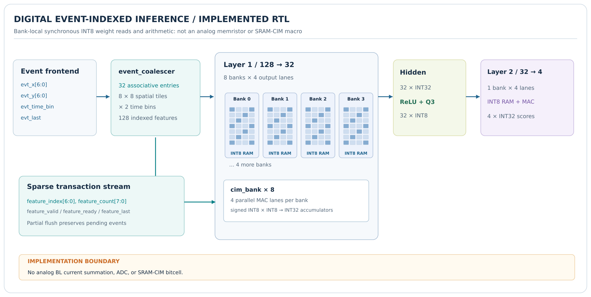
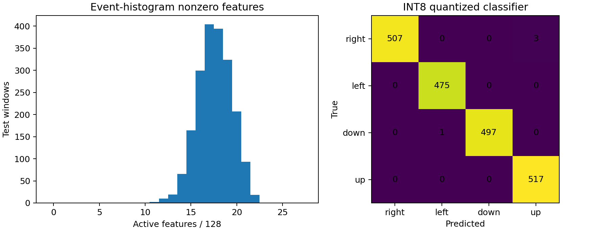

# SV_MemXbar / CIM-Vision: an event-indexed memory-centric inference fabric



The separate historical device-crossbar work and its [1T1R reference schematic](../docs/memristor_crossbar.svg) remain at the repository root. These are **not** the physical implementation of this digital inference engine.



**Verification:** 11 Python tests and the Icarus HDL simulation suite passed on the reported WSL run (November 6, 2026). These include parallel/bit-serial, dense/sparse, coalescer, signed-extrema and end-to-end tests. The latest Verilator lint, Yosys synthesis and benchmark-driver logs remain to be checked independently before a publication-ready release. The corrected signed-product extension and coalescer subpixel handling are in the local working tree.

## What is implemented

This is a synthesizable **digital near-memory / CIM-inspired architecture** for sparse event-camera feature inference. In-bank weight storage feeds in-bank arithmetic; in optional bit-serial mode each accepted signed INT8 input is multiplied by local weights through 8 sign-aware shift/add microsteps (without a DSP multiplier in that mode). A separate Boolean bitline-CIM **functional abstraction** computes `popcount(activity & positive_weight_mask) - popcount(activity & negative_weight_mask)` inside the bank boundary. These components are useful for exploring digital CIM, but **neither proves that computation occurred inside a physical SRAM cell**. Physical SRAM-CIM requires custom cell/periphery, PDK, layout and electrical verification.

`event_cim_top.sv` connects a raw event-to-feature **32-entry associative coalescer** with a complete, independently programmable 128→32→4 signed INT8/INT32 MLP. The entire inference computation occurs in RTL, including its intermediate ReLU/quantization; no Python neural-network step is interposed. A window carries timestamp **bin** (one bit), coordinates and end-of-window; per-tile ON/OFF polarity is not yet modeled. The coalescer handles over-capacity cases by partial flushes, **without** prematurely terminating the inference frame.

This build is a complementary digital inference path alongside the original memristor/1T1R model. It is not a calibrated analog memristor model, a validated analog CIM macro, or a ready-to-deploy event-camera driver.

## Demonstration and numerical evidence

Two consecutive 8×8 event histograms (128 scalar features) describe synthetic moving spots. A 32-hidden-neuron ReLU classifier predicts `right`, `left`, `down`, or `up`. The fixed training and testing generators use disjoint seeds.

| Metric | Measured software result |
|---|---:|
| Training / held-out test samples | 10,000 / 2,000 |
| Floating-point classifier accuracy | 99.8% |
| Quantized INT8/INT32 classifier accuracy | 99.8% (1996/2000) |
| Dense/sparse *exact* integer score agreement | 2000/2000 test windows |
| Mean active first-layer inputs | 17.581 / 128 |
| First-layer input record reduction | 86.26% |
| Both-layer bank-local **lane-read/update count** reduction | 83.65% |
| Weight storage / bias storage | 4,224 B / 144 B |

These numbers measure deterministic **synthetic software correctness and a data-movement proxy**, not FPGA clocks, area, Fmax, SRAM energy, total system latency, wall power or real-world recognition accuracy. See [`results/software_metrics.json`](results/software_metrics.json).

## Repo contents

```text
rtl/
  cim_bank.sv             one local synchronous weight memory per output lane;
                          parallel product OR 8-step signed bit-serial mode
  cim_layer.sv            event-indexed MVM with reset/emit/ready-valid FSM
  relu_q3.sv              exact RTL ReLU, round-half-up, INT8 saturation
  cim_vision_mlp.sv       two layers connected in RTL; output class scores
  event_coalescer.sv      raw event -> feature tile; CAM, partial flush, stalls
  event_cim_top.sv        integrated sensor-side logical pipeline
  bitline_bool_cim.sv     ternary weights, bitline AND + population count demo
models/                  frozen trained weights, bias, vectors, expected scores
tools/model.py            independent numerical oracle and synthetic generator
tools/train.py            seeded PyTorch training and Q5/Q3/Q8 quantizer
tools/benchmark.py        dense/sparse evaluation and traffic proxy
tests/                  HDL adversarial tests and NumPy/pytest oracle
../.github/workflows/    Parent-repository GitHub Actions regression
docs/                    architecture, PPA plan, limitations, research comparison
```

## Reproduce (Linux/WSL)

```bash
sudo apt-get update
sudo apt-get install -y make iverilog verilator yosys
python3 -m pip install numpy pytest matplotlib
cd SV_MemXbar/cim_vision
make reference          # 11 Python tests passed in preparation environment
python3 tools/benchmark.py
make demo               # prints one example event-to-logit trace
python3 tools/plot.py
make sim-all            # Icarus regression, requires local toolchain
make lint               # Verilator; strict width/latch warnings
make synth              # Yosys structural pass, not routed PPA
make bench-rtl           # Cycle-count comparison of dense/sparse and parallel/serial
make synth-generic      # Optional, potentially expensive Yosys generic gate mapping
# Optional retrain (adds PyTorch): python3 -m pip install torch
# make regenerate       # regenerates weights, fixed vectors and metrics
```

*The WSL Icarus suite passed; do not mark lint, synthesis, FPGA implementation or energy verified without their own passing logs.* The Icarus regression ran successfully in WSL; current Verilator and Yosys exit codes must still be captured.

## Frame/protocol contract

Top-level raw event `evt_valid/evt_ready` transfers `(x[6:0],y[6:0],time_bin,last,marker_only)` on positive edges. A 128×128 ROI is mapped via `feature={time_bin,y[6:4],x[6:4]}` to 128 features. Repeated events to one feature become an unsigned count 1..127; if table capacity or value range is exhausted, the coalescer **flushes partial non-final records** and retries the held event. The last output feature of the final segment carries `in_last=1`. A truly empty window uses a single `marker_only=1,last=1` transaction and emits `(feature=0,value=0,last=1)`.

Host programming `cfg_valid/cfg_ready` transfers `(layer,is_bias,index,output,weight,bias)` only when the two-layer engine is idle. Every input **weight** must be programmed before use; memory is intentionally not reset to enable RAM inference. Out-of-range layer-2 configuration raises sticky `protocol_error`. Output `out_valid/out_ready` transfers 4 ordered 32-bit score channels per inference, holding all payload signals stable across stalls. Reset is active-low asynchronous. The host performs `argmax`; score values are **Q8 integer logits**, not probabilities.

## Outstanding hardware validation

1. Preserve the passing Icarus regression; capture Verilator lint and Yosys structural-check exit codes, then run the benchmark driver and commit the reproducible results.
2. Run vendor synthesis against the documented Arty A7-100T part, supply real clock/pin constraints, and preserve area/timing reports; never infer silicon energy from toggle counts alone.
3. Add an actual UART or AXI peripheral, integrate a board, and capture live host-to-FPGA score equality and resource/timing reports.
4. Validate on **real** event recordings with subject-disjoint splits and compare dense, zero-gated dense and event-indexed dataflow under the same physical implementation assumptions.
5. For a genuine SRAM digital-CIM publication, replace or supplement the inferred RAM with a characterized compute-capable SRAM macro (custom cells/periphery). See [docs/RESEARCH.md](docs/RESEARCH.md).

See [technical architecture](docs/ARCHITECTURE.md), [physical proof requirements](docs/PPA_GUIDE.md), [research/novelty constraints](docs/RESEARCH.md), and [integration boundary](docs/INTEGRATION.md).

MIT License (new source in this add-on). Prior repository files remain under their existing terms.

## RTL benchmark interpretation

`make bench-rtl` uses the same 24 frozen test images and weights in four modes: parallel/dense, parallel/sparse, bit-serial/dense and bit-serial/sparse. It checks every score and reports cycles from the end of weight programming until the final class-score transfer. Cycles include input delivery, control, internal layer serialization and backpressure introduced by the testbench; there is no physical sensor or I/O interface. Results are written to `build/rtl_benchmark/performance.json` and are **not** a power or SRAM-access measurement.

The original `src/` and `TB/` implementations in the parent Git repository remain separate and are not compiled into the new digital datapath. Their modeling assumptions must not be confused with the inferred memory used here.
